<!-- Animated header -->

  

<!-- Typing animation -->

  

<!-- Live badges: profile views, followers, stars -->

  
  
  

---

## 👋 About Me

Senior Android Developer & Team Lead with **7+ years** of experience building high-performance,
scalable native Android apps in **Kotlin** and **Java**.

- 👥 Leading a team of 5+ Android developers rebuilding the **MageNative** app with **Jetpack Compose** & **Kotlin Flow**
- 🏗️ Architecture: MVVM-Clean, Clean Architecture, Hilt DI, Android Jetpack
- 🛒 Delivered **70+ eCommerce apps** (Shopify & Magento) for global clients
- 📈 Shipped apps with **1M+ downloads** and Play Store ratings up to **4.9 stars**
- 🔗 Expertise: GraphQL, Retrofit, Firebase, Coroutines, Algolia SDK
- 🤖 AI-assisted dev: Claude Code, Claude, ChatGPT, Gemini, GitHub Copilot, Cursor
- 📍 Lucknow, India

  
  
  
  

---

## 🛠️ Tech Stack

  

<b>Full stack details</b>

| Area | Tools |
|------|-------|
| **Languages** | Kotlin, Java, JavaScript |
| **Architecture** | MVVM, MVVM-Clean, Clean Architecture |
| **Jetpack** | Compose, ViewModel, LiveData, Room, WorkManager, ViewBinding |
| **DI** | Hilt, Dagger 2, Koin |
| **Networking** | Retrofit 2, GraphQL, OkHttp, Volley |
| **Firebase** | Analytics, FCM, Crashlytics |
| **Testing** | JUnit, Espresso |
| **CI/CD** | GitHub Actions, Git, Bitbucket |

---

## 📊 GitHub Stats

<!-- Stats and top-languages cards are regenerated daily by .github/workflows/profile-cards.yml -->

  <picture>
    <source media="(prefers-color-scheme: dark)" srcset="./profile/stats-dark.svg" />
    
  </picture>
  <picture>
    <source media="(prefers-color-scheme: dark)" srcset="./profile/top-langs-dark.svg" />
    
  </picture>

  <picture>
    <source media="(prefers-color-scheme: dark)" srcset="https://streak-stats.demolab.com/?user=sundramsinghdev007&theme=dark&hide_border=true&ring=3DDC84&fire=3DDC84&currStreakLabel=3DDC84" />
    
  </picture>

### 🐍 Contribution Snake

<!-- Regenerated daily by .github/workflows/profile-cards.yml -->

  <picture>
    <source media="(prefers-color-scheme: dark)" srcset="./profile/github-snake-dark.svg" />
    
  </picture>

---

## ⚡ Recent Activity

<!-- Updated automatically by .github/workflows/recent-activity.yml -->
<!--START_SECTION:activity-->
<!--END_SECTION:activity-->

---

## 🔗 Connect

  
  
  

<!-- Animated footer -->

  

